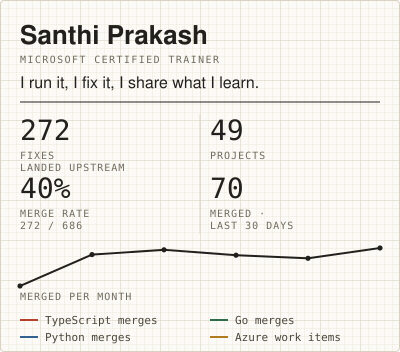
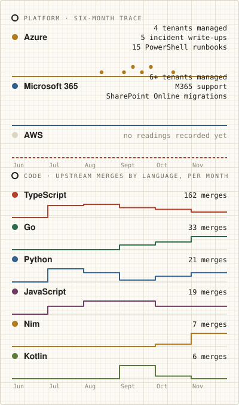
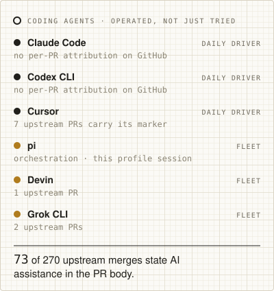
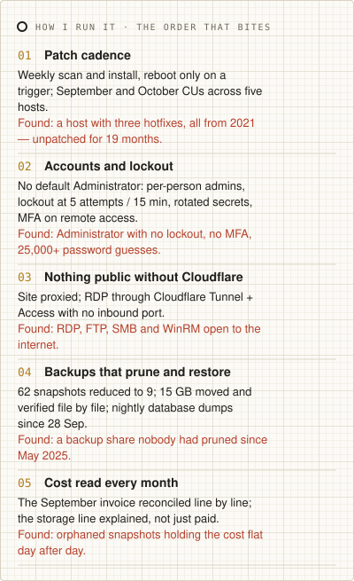
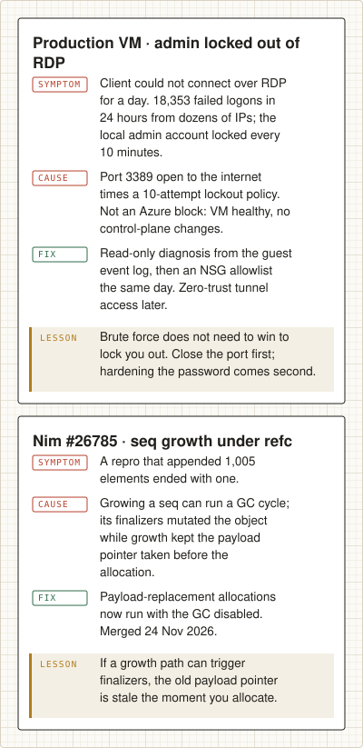

<picture>
  <source media="(min-width: 768px)" srcset="./assets/panel-nameplate.svg" />
  
</picture>

I run Azure operations for client tenants, land fixes in open-source projects people actually run, and share what I learn on the channel — build-first.

[santhiprakash.com](https://santhiprakash.com) · [LinkedIn](https://linkedin.com/in/santhiprakashb) · [YouTube](https://www.youtube.com/@santhiprakashb) · [connect@santhiprakash.com](mailto:connect@santhiprakash.com)

## 266 fixes landed upstream

Merged into other people's projects, counted 25 Nov 2026.

<picture>
  <source media="(min-width: 768px)" srcset="./assets/panel-lanes.svg" />
  
</picture>

<picture>
  <source media="(min-width: 768px)" srcset="./assets/panel-agents.svg" />
  
</picture>

### Live, per project

| Project | Contribution areas | Merged | Submitted |
|:--|:--|:--:|:--:|
| [**Synara**](https://github.com/Emanuele-web04/synara) | Coding-agent workspace — server behavior and the web UI |  |  |
| [**Reactive Resume**](https://github.com/reactive-resume/reactive-resume) | Privacy-first resume builder — forms, schema, a11y |  |  |
| [**OpenMausBot**](https://github.com/milind-soni/OpenMausBot) | Agentic desktop bot — Electron, Windows/macOS edge cases |  |  |
| [**Remotion**](https://github.com/remotion-dev/remotion) | Programmatic video with React |  |  |
| [**HyperFrames**](https://github.com/heygen-com/hyperframes) | HTML-to-video tooling for agents |  |  |
| [**OpenShip**](https://github.com/oblien/openship) | Self-hosted deployment platform |  |  |
| [**OpenAlgo**](https://github.com/marketcalls/openalgo) | Algorithmic trading platform — sandbox orders and docs |  |  |
| [**Beszel**](https://github.com/henrygd/beszel) | Lightweight server monitoring |  |  |
| [**Prettier**](https://github.com/prettier/prettier) | Opinionated code formatting |  |  |

## How I run it

The controls that matter, in the order that bites — and the finding that justified each one.

<picture>
  <source media="(min-width: 768px)" srcset="./assets/panel-controls.svg" />
  
</picture>

## Fixes, with the lesson

<picture>
  <source media="(min-width: 768px)" srcset="./assets/panel-cards.svg" />
  
</picture>

Latest merges: [Nim #26785](https://github.com/nim-lang/Nim/pull/26785) · [Salt #70810](https://github.com/saltstack/salt/pull/70810) · [Navidrome #6364](https://github.com/navidrome/navidrome/pull/6364)

## On the channel

Build-first walkthroughs — [subscribe](https://www.youtube.com/@santhiprakashb).

<table>
  <tr>
    <td width="33%" valign="top">
       
      <a href="https://www.youtube.com/watch?v=CVsvubTJsb0">ZCode: install, one safe change, verify</a>
    </td>
    <td width="33%" valign="top">
       
      <a href="https://www.youtube.com/watch?v=y8yeQb8wTa8">Granular: the terminal for everybody</a>
    </td>
    <td width="33%" valign="top">
       
      <a href="https://www.youtube.com/watch?v=JJ3DNTszo4o">Cline: free AI coding agent, full walkthrough</a>
    </td>
  </tr>
</table>

---

The pinned repositories are products I maintain. The table above highlights my work across open-source projects. [**santhiprakash.com**](https://santhiprakash.com) · [**connect@santhiprakash.com**](mailto:connect@santhiprakash.com)
